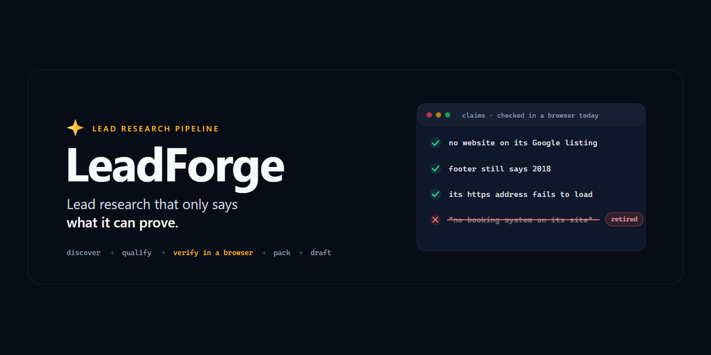
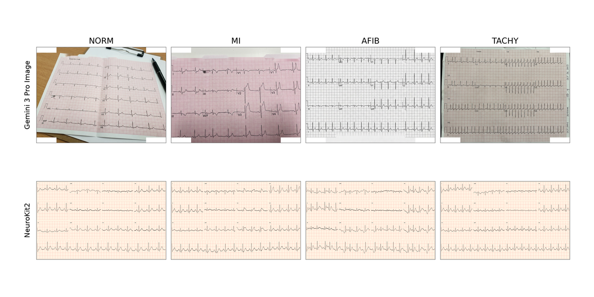
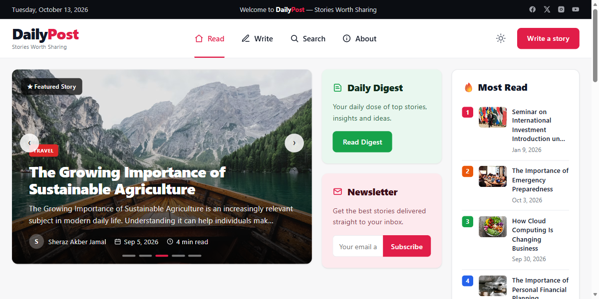
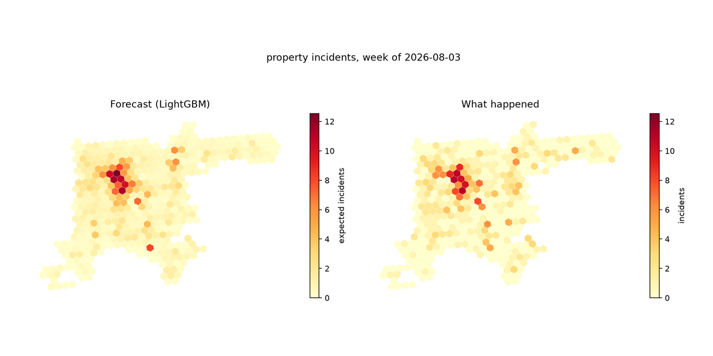

<h1>Taimour Khan</h1>

<b>Python automation · Web scraping · Data pipelines · Applied machine learning</b>

 

I am a Data Science student at the University of Management and Technology (UMT), Lahore, in the School of Systems and Technology.

I build things that run without me watching them, I test them, and I report a number only when I can show where it came from.

<table>
<tr>
<td align="center" width="25%"><b>4</b> projects shipped, 2 of them live</td>
<td align="center" width="25%"><b>1</b> first-author paper accepted</td>
<td align="center" width="25%"><b>325</b> agencies researched by my pipeline</td>
<td align="center" width="25%"><b>380,000</b> police records in my forecasting model</td>
</tr>
</table>

## Featured work

<table>
<tr>
<td width="50%" valign="top">

<h3>LeadForge</h3>

<b>Lead research that only says what it can prove.</b>

<ul>
<li>Finds small agencies, then builds each one a list of <b>ten prospects</b> in its own niche and city.</li>
<li>Checks every claim in a real browser on the day and attaches <b>the link that proves it</b>.</li>
<li><b>19 of 20</b> sample packs passed re-verification. The other was blocked, not stretched.</li>
<li>Drafts the outreach and <b>sends nothing</b>. A person sends each message.</li>
</ul>

<a href="https://github.com/TaimourKhan2132/Lead-Forge"><b>View the code</b></a> &nbsp;·&nbsp; <a href="https://taimourkhan2132.github.io/Lead-Forge/"><b>Open the live page</b></a>

</td>
<td width="50%" valign="top">

<h3>Synthetic ECG augmentation</h3>

<b>First-author paper, accepted at NEECON 2026, Dubai.</b>

<ul>
<li>Asks whether synthetic ECG images help a model classify arrhythmia in <b>real patients</b>.</li>
<li>Macro-F1 rose from <b>0.869 to 0.892</b> on PTB-XL (p &lt; 0.001 across 9 paired estimates).</li>
<li><b>No leakage</b>: patients are grouped across folds and the test set is real ECGs only.</li>
<li>Tests enforce those rules, and the tables can be recomputed without a GPU.</li>
</ul>

<a href="https://github.com/TaimourKhan2132/ecg-synthetic-research"><b>View the code and results</b></a>

</td>
</tr>
<tr>
<td width="50%" valign="top">

<h3>DailyPost</h3>

<b>A live news site, built and maintained solo.</b>

<ul>
<li>A community publication for a <b>non-technical owner</b>: readers submit stories and an editor approves them.</li>
<li>Taken from a front-end prototype to a <b>deployed site</b> with search, an editor dashboard and newsletter signups.</li>
<li>Hardened before launch: <b>CSRF tokens</b>, prepared statements, rate limits and a login lockout.</li>
</ul>

<a href="https://github.com/TaimourKhan2132/dailypost"><b>View the code</b></a> &nbsp;·&nbsp; <a href="https://dailypostpk.page.gd"><b>Open the live site</b></a>

</td>
<td width="50%" valign="top">

<h3>Denver Crime Forecasting</h3>

<b>Weekly forecasts for 430 areas of a city.</b>

<ul>
<li>Built from <b>380,000 police records</b> and tested only on future weeks.</li>
<li>For property crime, beat <b>all six baselines</b> in each of four test windows.</li>
<li>For crimes against people, it only tied a simple average, and the README says so.</li>
<li>Found and fixed a <b>7-hour timestamp bug</b> in the city's own data export.</li>
</ul>

<a href="https://github.com/TaimourKhan2132/DenverCrime"><b>View the code and results</b></a>

</td>
</tr>
</table>

## Stack

| Area | Tools |
|:---|:---|
| **Scraping and automation** | Python, Playwright, httpx, BeautifulSoup |
| **Data** | pandas, SQL, SQLite, MySQL |
| **Machine learning** | PyTorch, scikit-learn, LightGBM, NeuroKit2 |
| **Web** | PHP, HTML, CSS |
| **Tooling** | Git, GitHub Actions, pytest |

 

<b>Get in touch:</b> <a href="mailto:taimourwk2132@gmail.com">taimourwk2132@gmail.com</a> &nbsp;·&nbsp; <a href="https://www.linkedin.com/in/taimour-khan-869476382">LinkedIn</a>

